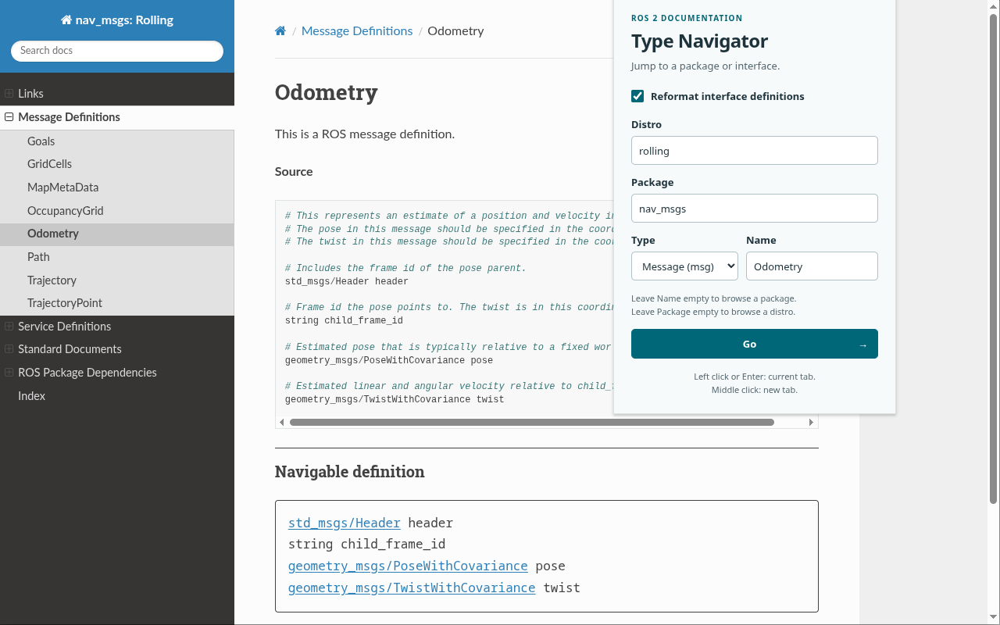

# ROS2 Type Navigator

Browse ROS 2 interface definitions without hunting down every referenced message type. This Firefox and Chrome extension adds a **Navigable definition** below the official Source block, with clickable types and less comment clutter. The original documentation stays intact.

Messages, services, and actions are supported. Links stay in the current ROS distribution, and services and actions retain their request/response and goal/result/feedback sections.



## Use the navigator

Click the toolbar icon to jump to a distribution, package, or interface. The popup fills in values from the current ROS page, or restores your last submitted values on other pages.

| Fill in | Open |
| --- | --- |
| Distro | Package listing |
| Distro + Package | Package documentation |
| Distro + Package + Type + Name | Message, service, or action definition |

An empty Distro uses `rolling`. Choose **Message**, **Service**, or **Action** for Type; each keeps its own Name draft while the popup is open.

- **Left click Go or press Enter:** open in the current tab.
- **Middle click Go:** open in a new background tab.
- **Reformat interface definitions:** show or hide the added definitions across open documentation tabs. This setting is remembered locally.

Try [PointCloud2](https://docs.ros.org/en/humble/p/sensor_msgs/msg/PointCloud2.html), [CancelGoal](https://docs.ros.org/en/humble/p/action_msgs/srv/CancelGoal.html), or [FollowJointTrajectory](https://docs.ros.org/en/rolling/p/control_msgs/action/FollowJointTrajectory.html).

## Install from source

Clone or download this repository. Load `extension/` directly; no build step or dependency installation is needed to use the extension.

### Chrome / Chromium

1. Open `chrome://extensions` and enable **Developer mode**.
2. Choose **Load unpacked** and select `extension/`.
3. Pin the extension from the extensions menu for easy access.

### Firefox

Firefox 157 or later is required.

1. Open `about:debugging#/runtime/this-firefox`.
2. Choose **Load Temporary Add-on…** and select `extension/manifest.json`.

Firefox removes temporary add-ons when it restarts. Use a signed distribution for a permanent installation.

Allow access to `docs.ros.org` if prompted, then reload any documentation tabs that were already open.

## Scope and privacy

The extension enhances current ROS 2 message, service, and action pages on `docs.ros.org`. Older documentation layouts and standalone IDL are unsupported. If the Source block cannot be identified, the page is left unchanged; unrecognized declarations remain plain text.

Processing happens in your browser. Submitted navigation values and the reformatting preference are stored locally; there is no analytics or browser sync. Private/incognito windows are disabled. See the [privacy policy](PRIVACY.md).

## Contribute

The extension uses plain JavaScript, HTML, and CSS. With Node.js 22.8+ and Python 3 installed:

```sh
./script/test.mjs
./script/package.py
```

The first command runs unit tests, syntax checks, and manifest/resource validation. The second runs those checks and creates Firefox and Chrome release ZIPs in `dist/`.

See the [contributor guide](docs/development.md) for browser tests and release instructions, the [behavior reference](docs/design.md) for supported syntax, and the [artwork guide](assets/README.md) for editing the icon.

## License

[GPL-3.0-or-later](LICENSE). Copyright © 2026 Seongyong Park and contributors.
