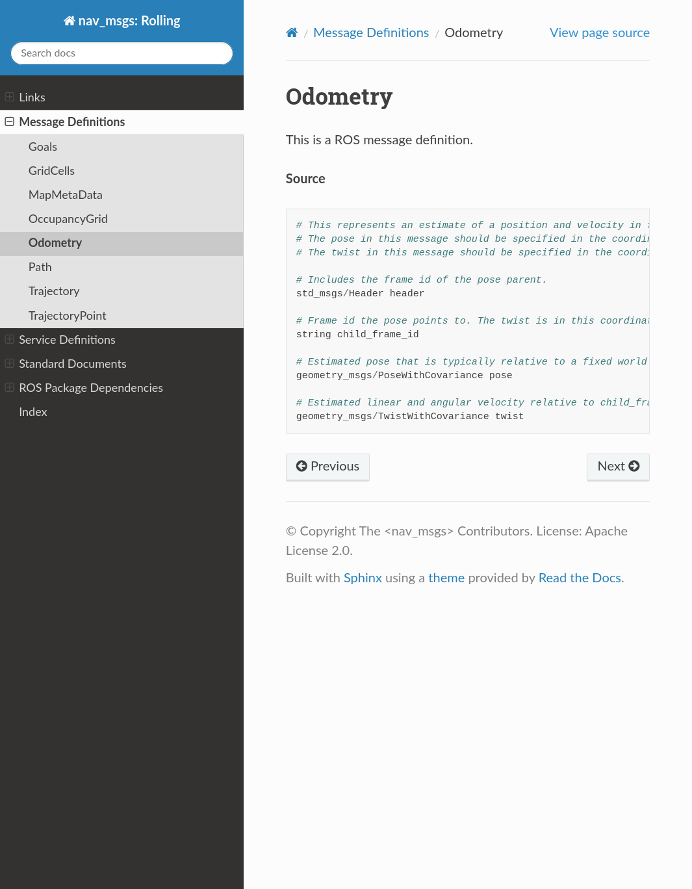
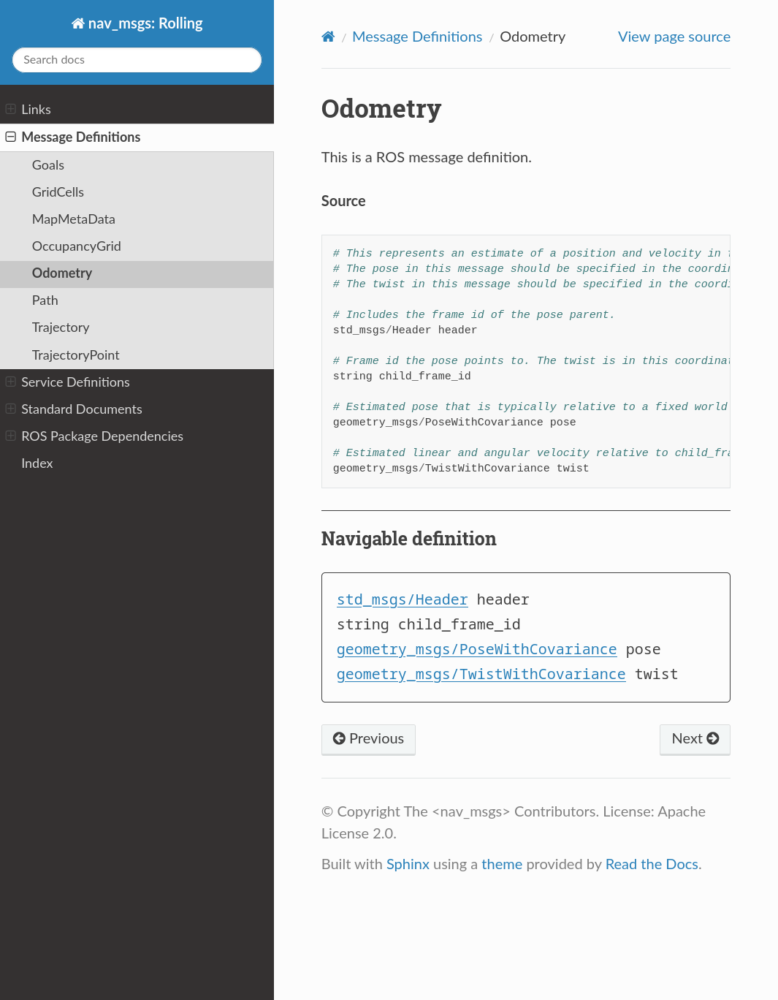
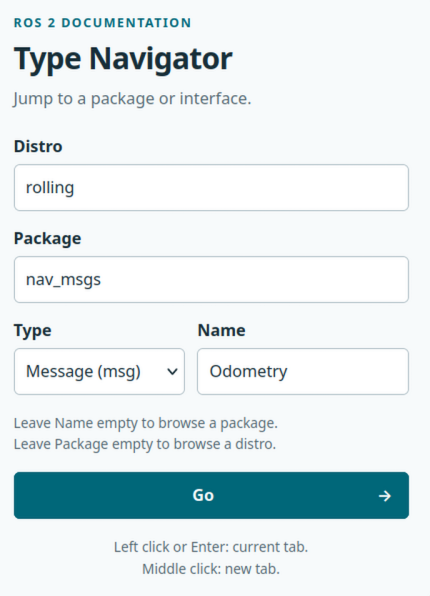

# ROS2 Type Navigator

A small Firefox/Chrome extension that adds clickable message types to official ROS 2 documentation. A toolbar popup jumps to distro listings, packages, messages, and services.

The original Source block stays intact. A **Navigable definition** appears below it, with comments removed and message types linked across packages. Service request and response sections stay separate.

## Screenshots

Original Odometry documentation:



With the navigable definition:



Toolbar navigator:



## Install locally

There is no build step, dependency installation, or server to run. Load the `extension/` directory directly. Node.js is only needed to run the development tests.

### Chrome / Chromium

1. Open `chrome://extensions` and enable **Developer mode**.
2. Click **Load unpacked** and select this repository's `extension/` directory.
3. Pin **ROS2 Type Navigator** from the extensions menu if you want a toolbar shortcut.
4. Allow access to `docs.ros.org` if prompted, then reload any ROS documentation tabs that were already open.

After editing extension files, click **Reload** on its extensions card and reload the documentation tab.

### Firefox

1. Open `about:debugging#/runtime/this-firefox`.
2. Click **Load Temporary Add-on…** and select `extension/manifest.json`.
3. Find **ROS2 Type Navigator** in the extensions menu and optionally pin it to the toolbar.
4. Allow access to `docs.ros.org` if prompted, then reload any ROS documentation tabs that were already open.

Temporary add-ons are removed when Firefox restarts. Repeat these steps after restarting; saved values should not be relied upon across temporary uninstall/reinstall. A persistent Firefox distribution would require signing, which is outside this first version. See [Firefox's temporary installation documentation](https://extensionworkshop.com/documentation/develop/temporary-installation-in-firefox/).

After editing files, click **Reload** beside the temporary add-on and reload the documentation tab.

## Use it

Visit a supported interface page, such as:

- [PointCloud2 (Humble)](https://docs.ros.org/en/humble/p/sensor_msgs/msg/PointCloud2.html)
- [CancelGoal (Humble)](https://docs.ros.org/en/humble/p/action_msgs/srv/CancelGoal.html)

Follow type links in the added definition normally, including opening them in a new tab or using Back. References always keep the current distro. Message fields inside a service correctly link to message definitions.

Click the toolbar button to open the navigator. It prefills from the current supported ROS page, or uses your last submitted values elsewhere. The first-use defaults are `rolling` and `msg`.

Switching Type keeps separate message and service Name drafts while the popup is open. An unused type starts with an empty Name. These drafts are discarded when the popup closes; only submitted navigation values are saved locally.

| Inputs | Destination |
| --- | --- |
| Distro only | Official package listing |
| Distro + Package | Official package landing page |
| Distro + Package + Type + Name | Official message or service page |

An empty distro uses `rolling`. Type does not affect listing destinations. The distro suggestions are optional: you can type a future distro name without updating the extension.

Left click Go or press Enter to open the destination in the current tab. Middle click Go to open it in a new background tab.

## Permissions and limits

See the [privacy policy](PRIVACY.md) for data use, local storage, and retention details.

- The content script runs only on `https://docs.ros.org/en/*` and enhances canonical `/en/<distro>/p/<pkg>/{msg|srv}/<name>.html` pages.
- `activeTab` reads the current tab's URL when you open the toolbar popup. `storage` remembers submitted values locally; nothing is synced or sent to an analytics service.
- The extension cannot be enabled in private or incognito windows.
- There is no background worker, documentation fetching, proxy, crawler, or hosted infrastructure. Normal navigation loads the official site in your browser.
- Legacy ROS 1/Foxy pages, alternate documentation URL layouts, actions, and standalone IDL are not supported. Use the popup to navigate to a supported distro and package.
- Missing or ambiguous Source blocks leave the page untouched. Unrecognized declarations remain plain text. The extension does not repair missing documentation or bypass site access challenges.
- The changes are local to your browser and do not affect search-engine rankings.

## Development and tests

```text
extension/          Directly loadable Firefox/Chrome extension
assets/             Promotional tile and artwork notes
scripts/            Optional artwork rendering tool
tests/              Unit tests, browser harness, and fixtures
docs/design.md      Behavior and constraints
docs/development.md Development findings and repository history
LICENSE             GNU GPL version 3; this project permits later versions
```

See the [design specification](docs/design.md) and [development notes](docs/development.md). The earlier `app/` prototype is preserved in the initial Git commit and has been removed from the current working tree.

The [artwork notes](assets/README.md) describe the SVG icon, promotional tile, and optional PNG rendering command. All rendered assets are included in the repository.

Run the dependency-free unit tests with Node.js 22 or newer:

```sh
node --test tests/*.test.cjs
```

For an interactive rendering/popup test harness, serve the repository locally (for example, `python3 -m http.server 8000 --bind 127.0.0.1`) and open `http://127.0.0.1:8000/tests/browser.html`. This server is only a development aid and is never needed to use the extension.

Automated browser checks use the installed `chromium` or `firefox` executable and Node's built-in WebSocket support. No driver or npm package is needed:

```sh
node tests/run-browser-tests.mjs chromium
node tests/run-browser-tests.mjs firefox
```

The runner uses disposable profiles, local debugging sockets, and fixture responses for documentation assertions. It loads the actual extension and checks automatic injection, ordinary link/Back navigation, tab creation, and real local storage. Firefox automation uses privileged access to its disposable test window to open extension pages; it does not use your normal browser profile. Browser screenshots are written to your system temporary directory.

To additionally check live ROS pages:

```sh
node tests/run-browser-tests.mjs chromium --live
node tests/run-browser-tests.mjs firefox --live
```

Live checks depend on the ROS site's availability and acceptance of automated browsers. A denial or missing page is reported as a failed live check, not silently counted as a pass.

### Validation record

- Node.js 26.9.0: 20 parser, routing, initialization, and submission tests passed.
- Chromium 153.0.8010.52 and Firefox 156.0: six DOM/popup fixture checks passed in each, plus installed-extension injection, links, Back, current-tab navigation, background tab creation, and persisted values.
- Branded Google Chrome was not available; Chromium was used for the Chromium-family checks.
- Firefox also passed live enhancement checks on Humble's `action_msgs/srv/CancelGoal` and `sensor_msgs/msg/PointCloud2`, with the expected same-package and cross-package links.
- A live Chromium check received the ROS site's Anubis **Access Denied** page, so live-site enhancement was not verified in that run. The extension correctly left the error page untouched.

Before distributing a release, also check a real toolbar popup on ordinary and ROS tabs, keyboard navigation/Enter, light/dark appearance, denied site access, and a live message/service page in each target browser.

## License

Copyright (C) 2026 Seongyong Park and contributors.

ROS2 Type Navigator is free software: you can redistribute it and/or modify it under the terms of the GNU General Public License as published by the Free Software Foundation, either version 3 of the License, or (at your option) any later version.

This program is distributed in the hope that it will be useful, but WITHOUT ANY WARRANTY; without even the implied warranty of MERCHANTABILITY or FITNESS FOR A PARTICULAR PURPOSE. See [LICENSE](LICENSE) for the full terms.

SPDX license identifier: `GPL-3.0-or-later`.
